# Auditoría de mi red doméstica

En este proyecto he analizado la red de mi casa: IPs, MAC, puertos, seguridad y velocidad. Está dividido en tres fases: **Fase 1, Inventario**; **Fase 2, Revisión del router**; y **Fase 3, Arreglos**. Al final hay un re-escaneo para comparar el antes y el después, un resumen de hallazgos y lo que he aprendido. Sin más dilación, comencemos.

Las capturas siguen el orden real en el que hice cada paso. Debajo de cada escaneo hay una tabla con lo que muestra la captura, dispositivo por dispositivo. He tapado los datos sensibles (MAC, contraseñas, códigos QR y parte del nombre de las redes wifi).

## Alcance y herramientas

| | |
|---|---|
| Red analizada | Mi red doméstica, con conocimiento de mi familia. Rango `192.168.1.0/24` |
| Equipo | MacBook (macOS 15.6.1), desde la app Terminal |
| Herramientas | Nmap 7.991 y el panel de administración del router (Vodafone F@st 5670, Sagemcom) |
| Fechas | Fase 1: 8 de octubre de 2026 · Fase 2: 10 de octubre · Fase 3 y re-escaneo: noche del 10 al 11 de octubre |

## Índice
1. [Conceptos básicos](#conceptos-básicos)
2. [Fase 1 – Inventario](#fase-1--inventario)
3. [Fase 2 – Revisión del router](#fase-2--revisión-del-router)
4. [Fase 3 – Arreglos](#fase-3--arreglos)
5. [Re-escaneo](#re-escaneo-después-de-los-arreglos)
6. [Resumen de hallazgos](#resumen-de-hallazgos-y-arreglos)
7. [Alcance](#alcance)
8. [Aprendizajes](#aprendizajes)

---

# Conceptos básicos

| Concepto | Qué significa |
|---|---|
| `192.168.1.0/24` | Mi red local: las 256 direcciones de `192.168.1.0` a `192.168.1.255`. En el texto abrevio cada IP por su final (.1, .128…) |
| IP | Dirección de cada dispositivo dentro de la red. La reparte el router (DHCP) y puede cambiar |
| MAC | Identificador de la tarjeta de red. Sus primeros caracteres indican el fabricante, que es lo que nmap muestra entre paréntesis |
| MAC aleatoria | Los móviles modernos inventan una MAC para no ser rastreados; por eso nmap no reconoce su fabricante y pone `Unknown` |
| Puerto | "Puerta" por la que un dispositivo ofrece un servicio (web, SSH, DNS…) |
| `open` / `closed` / `filtered` | Abierto: hay un servicio escuchando. Cerrado: el equipo responde que no hay nada. Filtrado: no hay respuesta, normalmente por un cortafuegos |
| Latencia | Lo que tarda el dispositivo en responder. Sirve para ver que está encendido |
| `sudo` | Ejecuta el comando como administrador. El Mac pide la contraseña del usuario (`Password:`), que no se ve al escribirla |

---

# Fase 1 – Inventario
*8 de octubre de 2026*

## 1. Descubrir los dispositivos (20:26)
```bash
sudo nmap -sn 192.168.1.0/24 -oN ~/Desktop/escaneo-dispositivos.txt
```

| Parte del comando | Qué hace |
|---|---|
| `sudo` | Lo ejecuta como administrador. Hace falta para que nmap pueda ver la MAC de cada dispositivo |
| `nmap` | La herramienta de escaneo |
| `-sn` | Solo comprueba qué dispositivos están encendidos, sin mirar puertos |
| `192.168.1.0/24` | Escanea toda mi red local |
| `-oN ~/Desktop/escaneo-dispositivos.txt` | Guarda el resultado en un archivo de texto en el Escritorio |

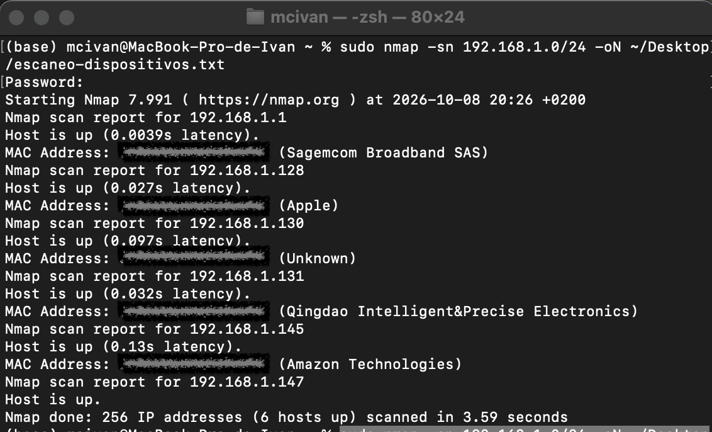

**Lo que muestra la captura:**

| IP | MAC | Fabricante (según la MAC) | Latencia | Dispositivo |
|---|---|---|---|---|
| .1 | tapada | Sagemcom Broadband SAS | 0,0039 s | Router |
| .128 | tapada | Apple | 0,027 s | Apple TV |
| .130 | tapada | Unknown | 0,097 s | Repetidor TP-Link (lo identifiqué en el paso 4) |
| .131 | tapada | Qingdao Intelligent&Precise Electronics | 0,032 s | Televisión (la identifiqué en la Fase 2) |
| .145 | tapada | Amazon Technologies | 0,13 s | Alexa |
| .147 | no aparece | – | – | Mi MacBook |

**Resultado:** 6 dispositivos encendidos en 3,59 segundos. La .147 no tiene línea de MAC porque es el propio MacBook desde el que escaneo: nmap no muestra la MAC del equipo que lanza el escaneo.

## 2. Escanear los puertos (20:41)
```bash
nmap -T4 --top-ports 100 192.168.1.0/24 -oN ~/Desktop/escaneo-puertos.txt
```

| Parte del comando | Qué hace |
|---|---|
| `-T4` | Velocidad "agresiva": hace el escaneo más rápido |
| `--top-ports 100` | Revisa solo los 100 puertos más usados de cada dispositivo |
| `192.168.1.0/24` | Toda mi red local |
| `-oN ~/Desktop/escaneo-puertos.txt` | Guarda el resultado en el Escritorio |

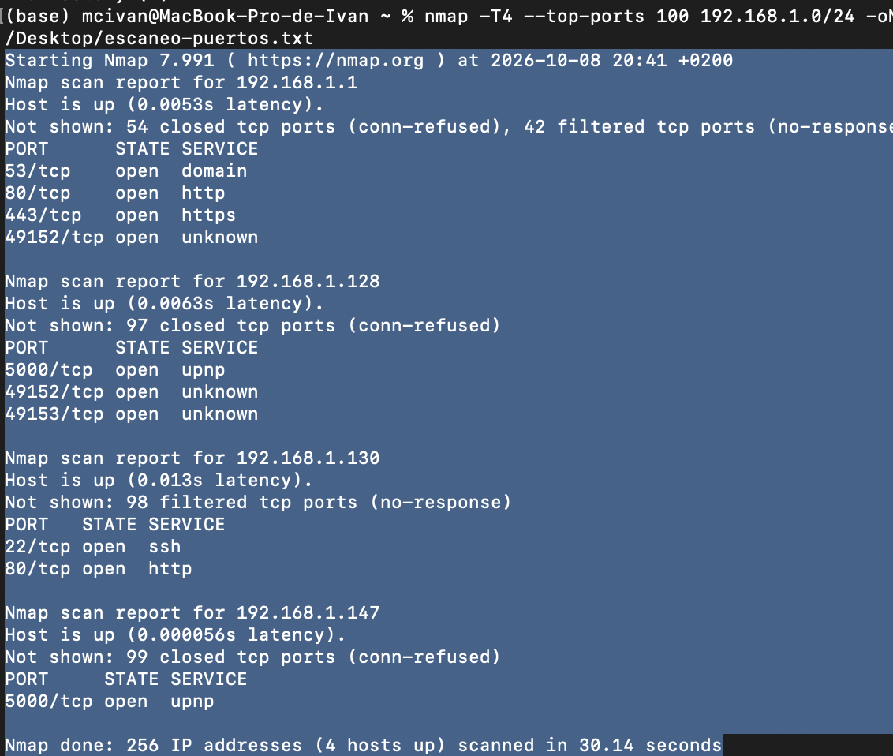

**Lo que muestra la captura:**

| IP | Dispositivo | Puertos abiertos | Resto de los 100 puertos |
|---|---|---|---|
| .1 | Router | 53 (`domain`), 80 (`http`), 443 (`https`), 49152 (`unknown`) | 54 cerrados y 42 filtrados |
| .128 | Apple TV | 5000 (`upnp`), 49152 (`unknown`), 49153 (`unknown`) | 97 cerrados |
| .130 | Repetidor | 22 (`ssh`), 80 (`http`) | 98 filtrados |
| .147 | Mi MacBook | 5000 (`upnp`) | 99 cerrados |
| .131 y .145 | Televisión y Alexa | No aparecen | – |

**Resultado:** 4 dispositivos con respuesta, en 30,14 segundos.

**Qué es cada puerto abierto:**

| Puerto | Servicio | Explicación |
|---|---|---|
| 53 | DNS | El router traduce nombres de páginas (como google.com) a direcciones IP |
| 80 | HTTP | Página web sin cifrar. En el router es el panel de administración |
| 443 | HTTPS | Página web cifrada. En el router es el mismo panel, de forma segura |
| 22 | SSH | Acceso remoto por terminal para administrar un equipo |
| 5000 | AirPlay | Nmap lo etiqueta como `upnp`, pero en macOS es el receptor de AirPlay. La .128 también es de Apple, así que probablemente sea lo mismo |
| 49152 y 49153 | Desconocido | Puertos altos que nmap no identifica. El 49152 del router desapareció después de desactivar UPnP (ver re-escaneo) |

**El caso de la .130.** Al principio supuse que la .130 era mi iPhone, pero este resultado no encajaba: un iPhone normal no tiene SSH ni un servidor web abiertos. Había algo en mi red con servicios de administración remota y no sabía qué era. Podía ser algo que pasa desapercibido, como un aparato smart, pero tenía que identificarlo. Además, comprobé la MAC real de mi iPhone (en el iPhone: Ajustes → General → Información → Dirección Wi-Fi) y no coincidía con la de la .130.

**¿Por qué no salen la .131 y la .145?** En el escaneo de dispositivos sí aparecían, pero aquí no. Este comando lo lancé sin `sudo`, y sin permisos de administrador nmap comprueba si un dispositivo está encendido intentando conectar a unos pocos puertos. Si no contesta a esos intentos, nmap lo da por apagado y no le escanea los puertos. Por eso más adelante probé la .131 por separado (paso 5).

## 3. Repetir el descubrimiento (20:48)
```bash
sudo nmap -sn 192.168.1.0/24
```
El mismo comando del paso 1, pero sin `-oN`, así que esta vez no lo guardé en archivo.

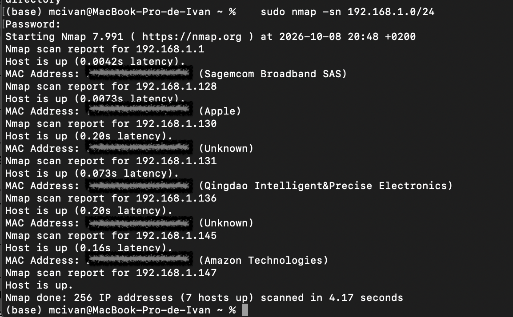

**Lo que muestra la captura:**

| IP | MAC | Fabricante (según la MAC) | Latencia | Dispositivo |
|---|---|---|---|---|
| .1 | tapada | Sagemcom Broadband SAS | 0,0042 s | Router |
| .128 | tapada | Apple | 0,0073 s | Apple TV |
| .130 | tapada | Unknown | 0,20 s | Repetidor |
| .131 | tapada | Qingdao Intelligent&Precise Electronics | 0,073 s | Televisión |
| .136 | tapada | Unknown | 0,20 s | **Mi iPhone (nuevo)** |
| .145 | tapada | Amazon Technologies | 0,16 s | Alexa |
| .147 | no aparece | – | – | Mi MacBook |

**Resultado:** 7 dispositivos en 4,17 segundos. Aparece la .136, mi iPhone, que en el primer escaneo no había contestado. Sale como `Unknown` porque usa MAC aleatoria. Los móviles en reposo no siempre responden, por eso conviene repetir el escaneo.

## 4. Identificar la .130 (20:53)
```bash
nmap -sV -p 22,80 192.168.1.130
```

| Parte del comando | Qué hace |
|---|---|
| `-sV` | Pregunta qué programa y qué versión responden en cada puerto |
| `-p 22,80` | Limita la prueba a los puertos 22 y 80, los que estaban abiertos |
| `192.168.1.130` | Solo este dispositivo |

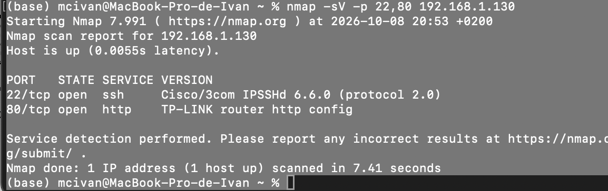

**Lo que muestra la captura:**

| Puerto | Estado | Servicio | Versión |
|---|---|---|---|
| 22 | open | ssh | `Cisco/3com IPSSHd 6.6.0 (protocol 2.0)` |
| 80 | open | http | `TP-LINK router http config` |

**Resultado:** el puerto 80 es el panel web de un aparato TP-Link. La versión del puerto 22 es la estimación de nmap, no lo he verificado.

**Conclusión:** la .130 es mi **repetidor TP-Link TL-WA850RE**. Lo confirmé después en el panel del router (Fase 2), donde aparece con ese nombre y esa IP.

## 5. Comprobar la .131 (20:56)
```bash
nmap -sV -T4 --top-ports 100 192.168.1.131
```
Combina las opciones anteriores: los 100 puertos más usados, rápido y detectando versiones, solo en la .131.

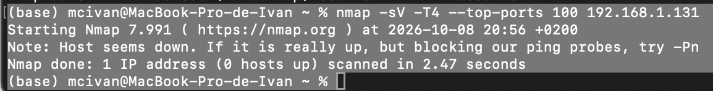

**Lo que muestra la captura:**

| IP | Resultado | Tiempo |
|---|---|---|
| .131 | `Note: Host seems down` · 0 dispositivos encendidos | 2,47 s |

**Resultado:** el dispositivo había aparecido en el escaneo de dispositivos, pero no respondió a este. Nmap indica que puede estar bloqueando el ping y sugiere repetir la prueba con `-Pn`, que se salta esa comprobación. No llegué a repetirla con `-Pn`.

Por el fabricante de su MAC (Qingdao Intelligent&Precise Electronics) sospechaba que era la televisión, y lo confirmé más adelante con el registro del router (Fase 2).

## Resultado de la Fase 1

| IP | Fabricante (según la MAC) | Primera hipótesis | Identificación final |
|---|---|---|---|
| .1 | Sagemcom | Router | Router |
| .128 | Apple | Apple TV | Apple TV (conectado por cable; en el router se llama "Sala-de-estar") |
| .130 | Desconocido | Mi iPhone ❌ | Repetidor TP-Link TL-WA850RE (paso 4 y panel del router) |
| .131 | Qingdao Intelligent&Precise | Televisión | Televisión (su MAC coincide con la del dispositivo `WL_VIDEO_5G` del registro del router, Fase 2) |
| .136 | Desconocido (MAC aleatoria) | – | Mi iPhone |
| .145 | Amazon Technologies | Alexa | Alexa |
| .147 | – (equipo desde el que escaneo) | Mi MacBook | Mi MacBook (en el router se llama "MacBookPro") |

---

# Fase 2 – Revisión del router
*10 de octubre de 2026*

## Cómo entré al panel
1. Busqué la dirección del router en el Mac: **Ajustes del Sistema → Wi-Fi → Detalles (de mi red) → Router**. Es `192.168.1.1`.
2. Escribí `192.168.1.1` en la barra de direcciones. En mi navegador habitual no cargaba; con Safari sí.
3. Inicié sesión con el usuario y la contraseña de la etiqueta del router.

Router: **Vodafone F@st 5670** (Sagemcom). La página de inicio tiene tarjetas (F@st 5670, Access Control, Wi-Fi 2.4GHz, Wi-Fi 5GHz…) con una rueda dentada que abre los ajustes de cada apartado.

## Pantalla de inicio (sin captura publicada)
No publico estas capturas porque muestran los nombres de las redes y de los dispositivos. Lo que vi:
- Tres redes wifi: 2,4 GHz, 5 GHz y una de invitados.
- **Todos los dispositivos estaban conectados a la red de 2,4 GHz.** La de 5 GHz y la de invitados no tenían ningún dispositivo.
- Por cable (tarjeta LAN) solo estaba el Apple TV ("Sala-de-estar", .128).

| Dispositivo | IP | Señal | Velocidad de conexión |
|---|---|---|---|
| Mi iPhone | .136 | −47 dBm | 216,66 Mbps |
| Mi MacBook | .147 | −34 dBm | 229,41 Mbps |
| iPhone de mi madre | .150 | −45 dBm | 229,41 Mbps |
| Alexa (sin nombre) | .145 | −41 dBm | 65 Mbps |
| Galaxy de mi hermano | .144 | −63 dBm | 72,222 Mbps |
| iPad de mi madre | .146 | −39 dBm | 130 Mbps |

La señal se mide en dBm: cuanto más cerca de 0, mejor (−34 es muy buena, −63 es aceptable).

## Cifrado de la wifi
**Ruta:** tarjeta Wi-Fi 2.4GHz (rueda dentada) → pestaña **Basic**.

**WPA2 Personal** en 2,4 y 5 GHz. Es un cifrado correcto. Las contraseñas son las de fábrica y distintas entre las dos bandas.

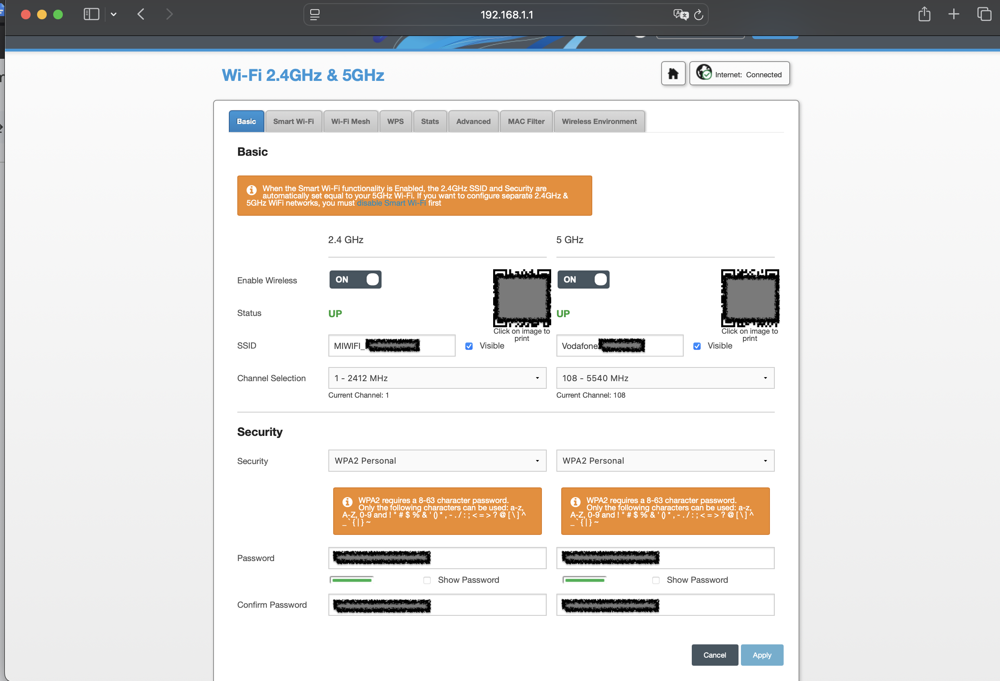

## WPS
**Ruta:** misma página → pestaña **WPS** → botón **2.4 GHz** y después **5 GHz**.

**Activado en las dos bandas.** El emparejamiento por PIN de WPS tiene fallos conocidos, así que es un hallazgo.

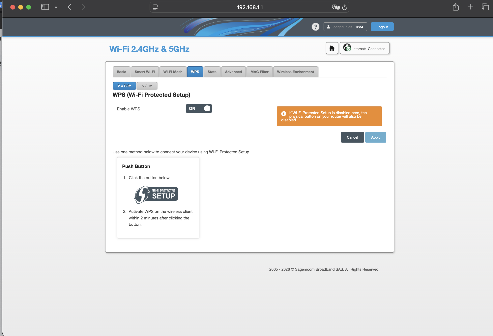
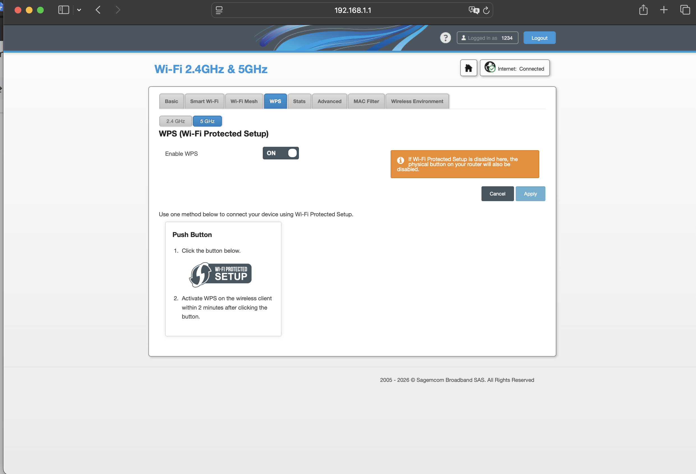

## Access Control
**Ruta:** tarjeta Access Control (rueda dentada). Tiene seis pestañas: Parental Control, Port Forwarding, Firewall IPv4, Firewall IPv6, DMZ y User.

**Parental Control:** desactivado (interruptor en OFF). En la lista de dispositivos aparece uno llamado `ESP_089145`; ESP es un chip habitual en aparatos de domótica, pero no he podido identificar cuál es.

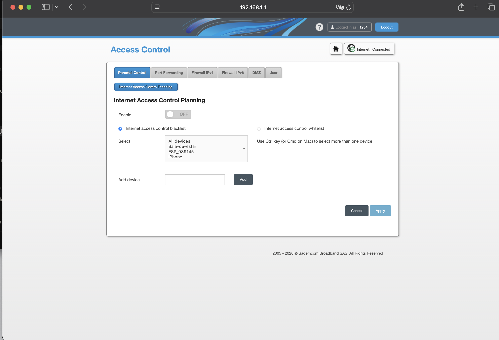

**Port Forwarding → UPnP IGD: activado.** El propio router avisa de que puede ser un riesgo. La tabla de reglas de reenvío de puertos estaba vacía.

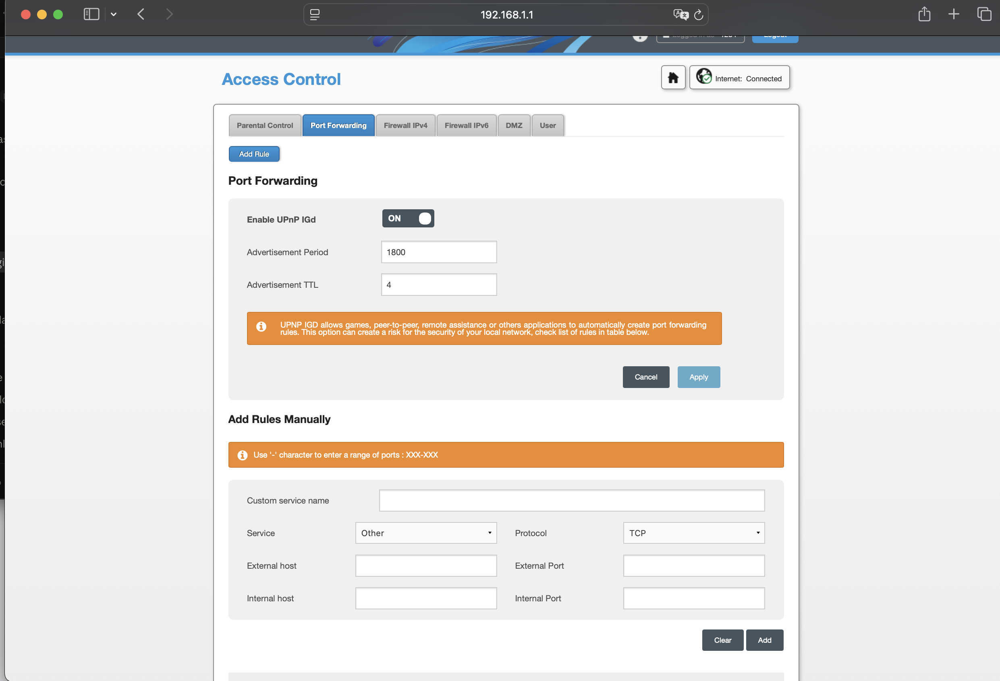

**Firewall IPv4: nivel Low**, con LAN→WAN y WAN→LAN en "Allow all" (todo permitido en los dos sentidos) y "Respond To Ping" activado. LAN es mi red de casa y WAN es internet. El firewall IPv6 estaba igual.

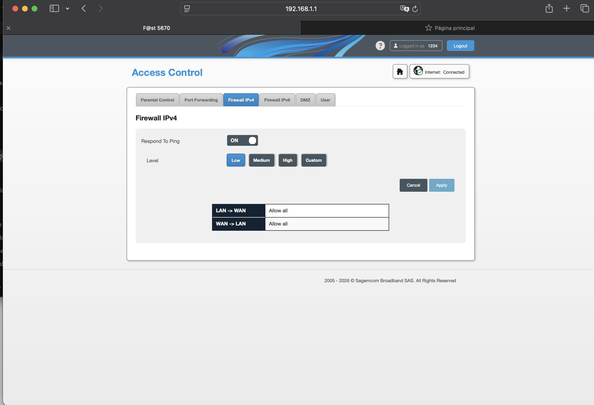

**DMZ: desactivada.** La DMZ expone un dispositivo directamente a internet; que esté apagada es lo correcto.

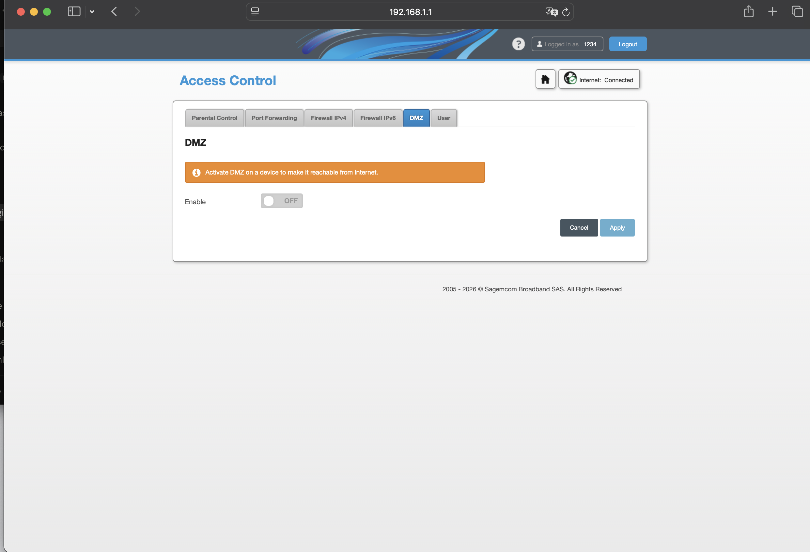

**User:** el usuario del panel es `1234` y no se puede cambiar (el campo está gris); solo se puede cambiar la contraseña. La contraseña también era la de fábrica, `1234`. Esa contraseña ya no sirve, porque la cambié en la Fase 3; el usuario sigue siendo el mismo.

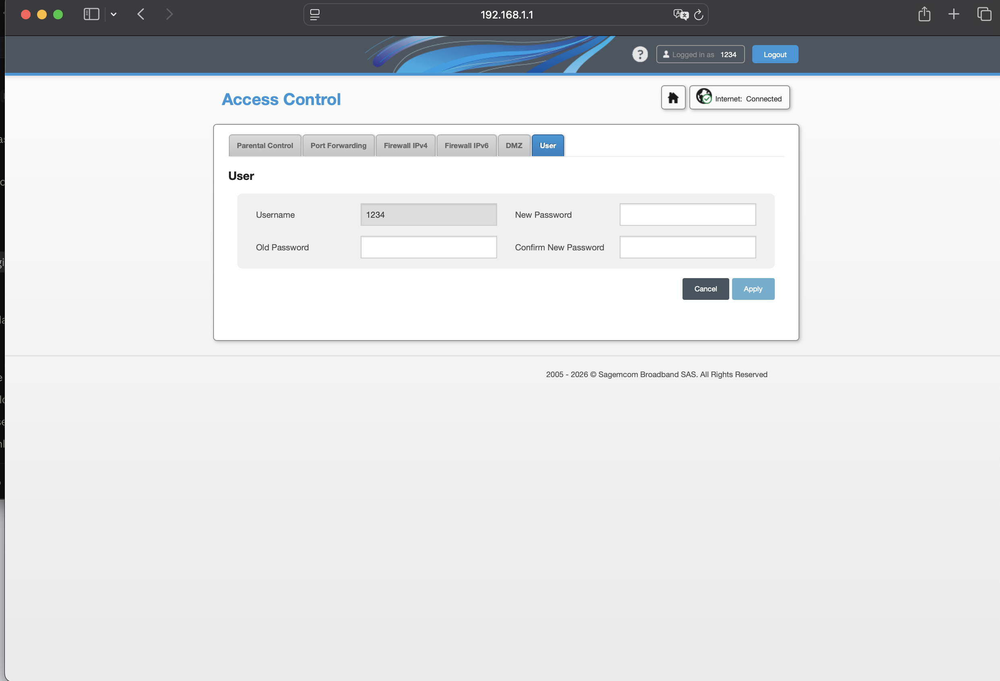

## Información del dispositivo (sin captura publicada)
**Ruta:** tarjeta F@st 5670 → pestaña **Device Info** → **General**.

No publico esta captura porque muestra el número de serie, las MAC y la IP pública.

| Dato | Valor |
|---|---|
| Hardware | 2.00 |
| Software (firmware) | `SGDV20000151`. Las actualizaciones las gestiona el operador |
| Interfaz | 5.122.1 |
| Tiempo encendido | 3 días y 18 horas sin reiniciarse |
| Memoria en uso | 76 % |
| Red local | `192.168.1.0/24`, router en `192.168.1.1` |

## Concesiones DHCP (sin captura publicada)
**Ruta:** Device Info → **DHCP Leases**. Es la lista de dispositivos a los que el router ha dado IP.

| IP | Nombre en el router | Dispositivo |
|---|---|---|
| .128 | Sala-de-estar | Apple TV |
| .130 | TL-WA850RE | Repetidor TP-Link |
| .136 | iPhone | Mi iPhone |
| .140 y .144 | Galaxy-M12 | Móvil de mi hermano (aparece dos veces; posible MAC aleatoria distinta por red, sin verificar) |
| .145 | (sin nombre) | Alexa |
| .146 | iPad | iPad de mi madre |
| .147 | MacBookPro | Mi MacBook |
| .150 | iPhone | iPhone de mi madre |

## Registros del router
**Ruta:** tarjeta F@st 5670 → pestaña **Maintenance** → **Logs**. Revisé la página 1 de 15 (de 02:50 a 11:35).
- **No hay accesos al panel de nadie más** en esas entradas.
- **Gestión remota del operador:** cada 2 horas el router se conecta a `acs.masmovil.com` mediante TR-069, el sistema con el que el operador gestiona el router a distancia. Buscando información he visto que es habitual en routers de operador. No se puede desactivar desde el panel.
- **Nombres internos de red:** el router usa nombres con el patrón `WL_…`. Mi iPhone se conectó a las 10:00 a `WL_PRIV`, mi red privada. También aparece `WL_VIDEO_5G`, del que se desconectó un dispositivo a las 10:55. Al comparar su MAC con el primer escaneo, **coincide exactamente con la de la .131**, así que es la televisión.
- **Errores DNS repetidos:** consultas de mis dispositivos (Bonjour, calendario) que el router no sabe resolver. No tienen importancia.

## Red de invitados
Desactivada. Sin hallazgo.

## Hallazgos de la Fase 2
- Contraseña del panel de fábrica.
- WPS activado en las dos bandas.
- UPnP activado.
- Firewall en el nivel más permisivo (Low) en IPv4 e IPv6.

---

# Fase 3 – Arreglos
*Noche del 10 al 11 de octubre de 2026*

Para cada arreglo indico por qué lo hago, el objetivo, cómo lo hice, el antes, el después y sus límites. En todos los cambios del panel hay que pulsar **Apply** para guardarlos.

## Arreglo 1: Desactivar WPS (2,4 y 5 GHz)
- **Por qué:** el WPS por PIN tiene debilidades conocidas. El PIN de 8 dígitos se puede adivinar y da acceso a la wifi sin conocer la contraseña.
- **Objetivo:** cerrar esa vía de acceso.
- **Cómo lo hice:** Wi-Fi 2.4GHz & 5GHz → pestaña **WPS** → **2.4 GHz** → interruptor **Enable WPS** en OFF → **Apply**. Lo mismo en **5 GHz**.
- **Antes:** activado en las dos bandas.
- **Después:** desactivado en ambas, comprobado en el panel. Como avisa el propio router, también queda desactivado el botón físico de WPS.
- **Límite:** solo afecta a quien esté al alcance de la señal. Para conectar un aparato nuevo hay que escribir la contraseña.

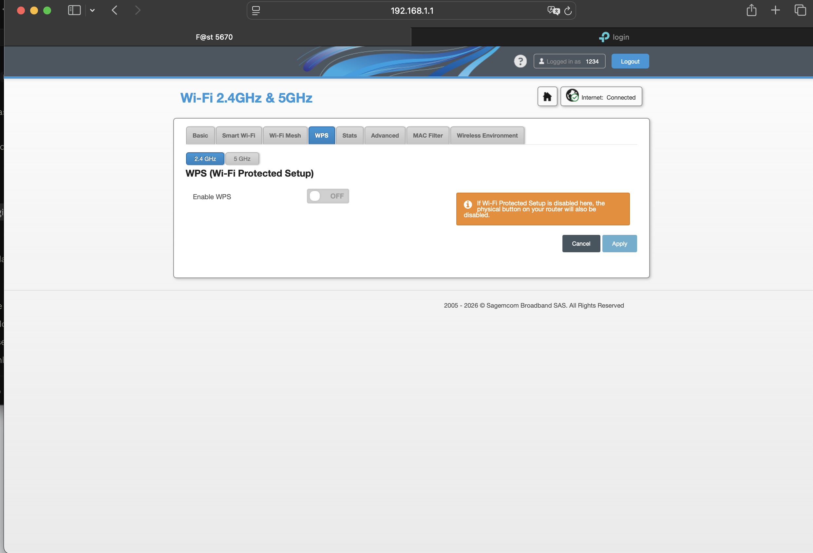
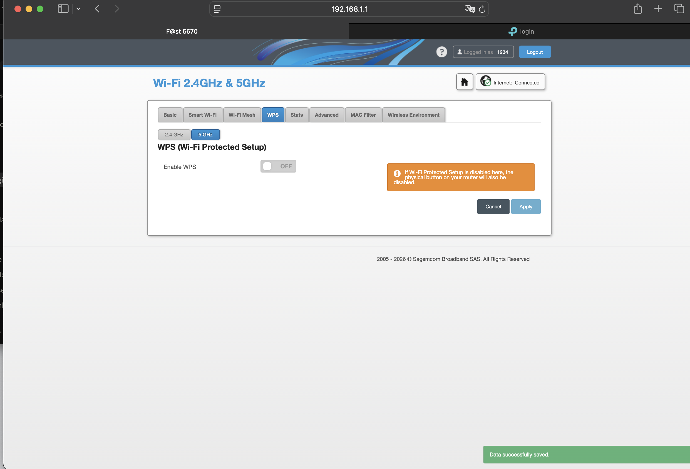

## Arreglo 2: Contraseña del panel del router
- **Por qué:** el panel usaba la contraseña de fábrica. Cualquier dispositivo conectado a mi wifi podía entrar y cambiar la configuración.
- **Objetivo:** que solo yo pueda administrar el router.
- **Cómo lo hice:** Access Control → pestaña **User** → escribí la contraseña antigua en **Old Password** y la nueva en **New Password** y **Confirm New Password** → **Apply**.
- **Antes:** usuario y contraseña de fábrica.
- **Después:** contraseña nueva, larga y única, guardada en un gestor de contraseñas. El router lo confirmó con el mensaje "Data successfully saved".
- **Límite:** el operador sigue gestionando el router a distancia (TR-069); eso no lo controlo yo.

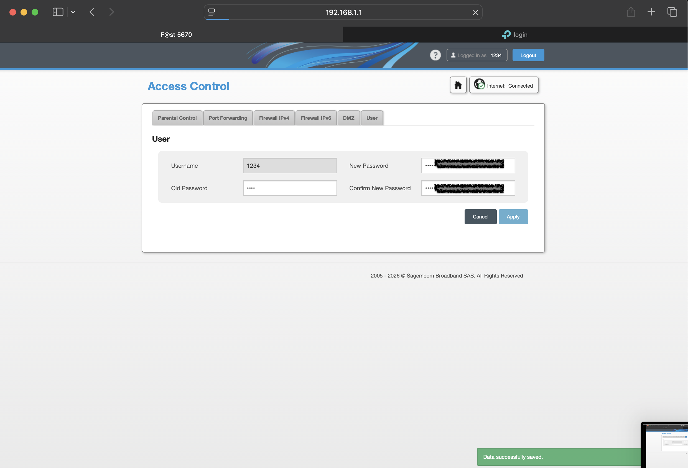

## Arreglo 3: Firewall de Low a Medium (IPv4 e IPv6)
- **Por qué:** estaba en el nivel más permisivo en las dos versiones.
- **Objetivo:** añadir una capa más de defensa.
- **Cómo lo hice:** Access Control → pestaña **Firewall IPv4** → botón **Medium** → **Apply**. Lo mismo en **Firewall IPv6**.
- **Antes:** Low, con todo permitido en los dos sentidos.
- **Después:** según el panel, ahora se bloquea el tráfico NetBIOS que entra desde internet (WAN→LAN: "Block all below: NETBIOS"). La salida (LAN→WAN) sigue permitida.
- **Límite:** el router ya hace NAT, que de por sí bloquea las conexiones entrantes que nadie ha pedido, así que la mejora real es probablemente pequeña. Desde el cambio no he notado problemas de conexión.

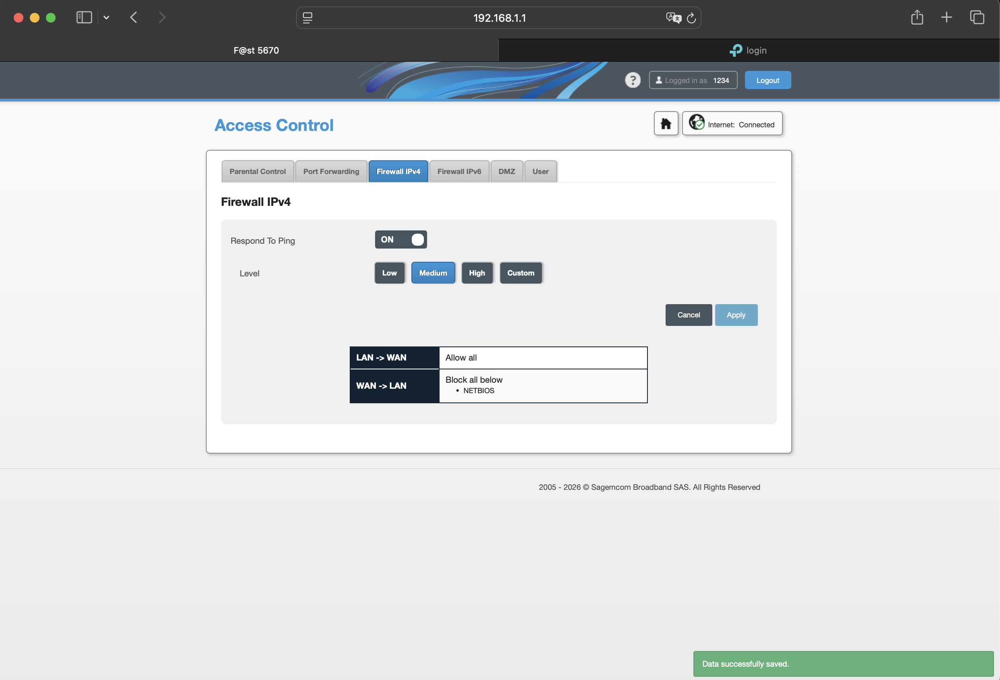
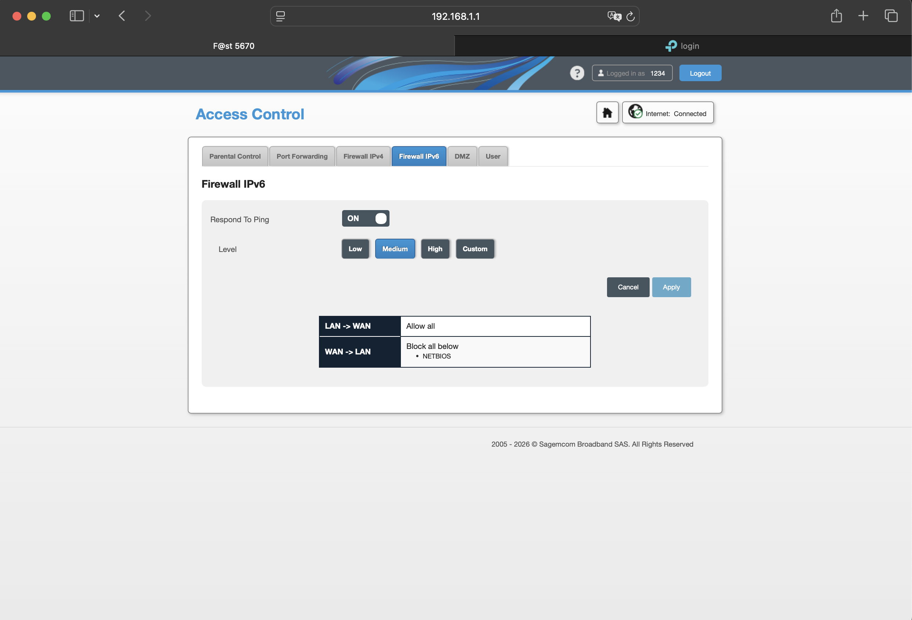

## Arreglo 4: Desactivar UPnP
- **Por qué:** UPnP deja que cualquier aparato de la red abra puertos hacia internet sin avisarme. No había reglas abiertas, así que es prevención.
- **Objetivo:** que los puertos solo se abran si yo lo decido.
- **Cómo lo hice:** Access Control → pestaña **Port Forwarding** → interruptor **Enable UPnP IGd** en OFF → **Apply**.
- **Antes:** activado, con la tabla de reglas vacía.
- **Después:** desactivado, comprobado en el panel.
- **Límite:** puede afectar a consolas, juegos en línea o algunas videollamadas. Desde el cambio no he notado problemas.

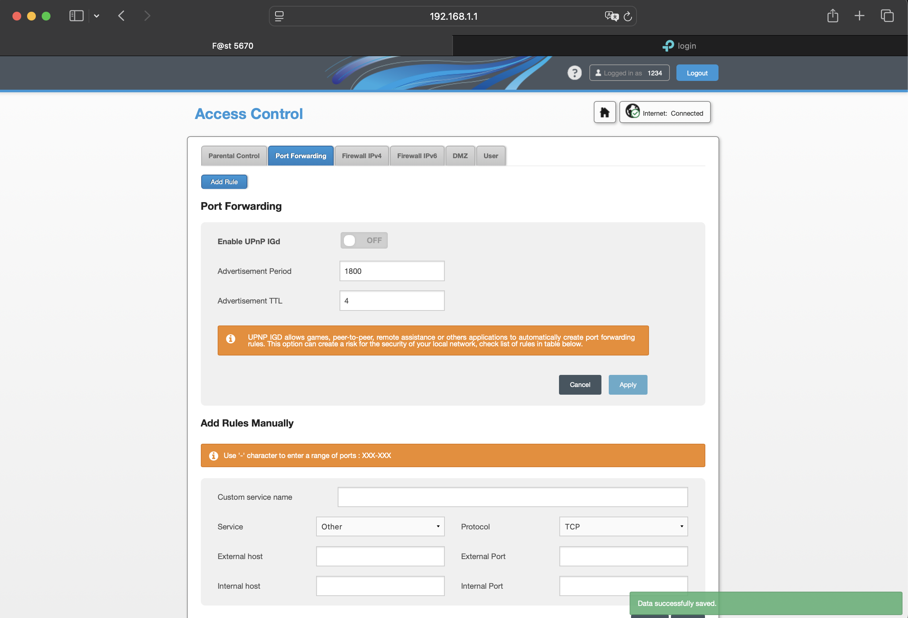

## Arreglo 5: Revisión del repetidor TP-Link (TL-WA850RE)
- **Por qué:** tiene su propio panel de administración dentro de mi red, con SSH (22) y web (80) abiertos según el escaneo.
- **Cómo lo hice:** escribí `192.168.1.130` en el navegador, lo que abre la página de inicio de sesión del repetidor, y probé las credenciales de fábrica.
- **Resultado:** no las acepta; mi hermano cambió la contraseña al instalarlo.
- **Cambio:** ninguno.
- **Límite:** no he podido comprobar la fortaleza de esa contraseña ni la versión del firmware.

## Arreglo 6: Cambiar el MacBook a la banda de 5 GHz
Este arreglo no es de seguridad, sino de velocidad.

**Situación inicial**
- El router tiene dos redes: 2,4 GHz y 5 GHz. Todos mis dispositivos usaban la de 2,4 GHz, porque era la que se guardó la primera vez que se conectaron.
- Al empezar creí que la red de 5 GHz era una que termina en `_EXT`. No lo era: esa es probablemente la del repetidor (sin verificar). La de 5 GHz tenía un nombre totalmente distinto, que encontré en el panel del router (Wi-Fi 2.4GHz & 5GHz → Basic). Su contraseña, que consulté en esa misma página, también era distinta de la de 2,4 GHz.

**Por qué 5 GHz**
- 5 GHz ofrece más velocidad y sufre menos interferencias que 2,4 GHz, a cambio de menos alcance y de atravesar peor las paredes.
- Uso el MacBook cerca del router (señal de −34 dBm), así que la pérdida de alcance no me afecta.
- No moví el resto de dispositivos: están más lejos, algunos aparatos de domótica solo funcionan en 2,4 GHz, o dependen del repetidor.

**Cómo lo hice:** en el MacBook, icono de Wi-Fi de la barra de menús → elegí la red de 5 GHz → escribí su contraseña.

**Cómo lo medí:** hice tests de velocidad en la web testvelocidad.es (botón **INICIO**) para comprobar la diferencia entre las dos bandas, en el mismo sitio, a la misma hora aproximada y siempre con el MacBook.

| Banda | Descarga | Subida | Ping |
|---|---|---|---|
| 2,4 GHz | 97,17 Mbit/s | 84,75 Mbit/s | 11 ms |
| 5 GHz | 744,9 Mbit/s | 618,6 Mbit/s | 11 ms |

- **Descarga:** velocidad al recibir datos (ver vídeos, descargar).
- **Subida:** velocidad al enviar datos (subir archivos, videollamadas).
- **Ping:** lo que tarda en ir y volver un paquete; cuanto más bajo, mejor.


**Resultado:** la descarga pasó de 97 a 745 Mbit/s, **unas 7,7 veces más**, y la subida de 85 a 619 Mbit/s. La mejora es solo para este equipo.

**Por qué la diferencia es tan grande (hipótesis, no lo he medido por separado):**
- **Competencia:** en 5 GHz el MacBook era el único dispositivo, así que no tenía que esperar turno para comunicarse con el router. En 2,4 GHz compartía la banda con todos los demás.
- **Señal:** a más distancia y más paredes, más débil llega la señal y menor es la velocidad, aunque la red esté vacía. La de 5 GHz se debilita antes que la de 2,4 GHz.

**A tener en cuenta:**
- La velocidad máxima también depende de la línea contratada, que desconozco.
- La velocidad de la wifi varía según la hora y lo que se esté usando en casa, así que los valores son orientativos.

**Cambio de nombre de la red de 5 GHz.** Para distinguirla fácilmente, en Wi-Fi 2.4GHz & 5GHz → **Basic** → campo **SSID** de 5 GHz, le puse el mismo nombre que la red de 2,4 GHz terminado en `_5G` → **Apply**.

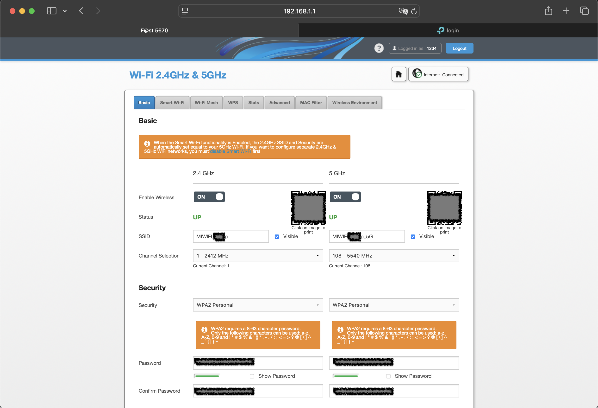

---

# Re-escaneo (después de los arreglos)
*11 de octubre de 2026, 01:25*

Lancé los mismos comandos que en la Fase 1, guardándolos con otro nombre para no sobrescribir los archivos del "antes":
```bash
sudo nmap -sn 192.168.1.0/24 -oN ~/Desktop/escaneo-dispositivos-despues.txt
nmap -T4 --top-ports 100 192.168.1.0/24 -oN ~/Desktop/escaneo-puertos-despues.txt
```

**Dispositivos encontrados (`-sn`): 8**

| IP | Dispositivo | ¿Estaba antes? |
|---|---|---|
| .1 | Router | Sí |
| .128 | Apple TV | Sí |
| .130 | Repetidor | Sí |
| .134 | Ordenador de sobremesa (a través del repetidor) | **Nuevo** |
| .136 | Mi iPhone | Sí (en la repetición del paso 3) |
| .145 | Alexa | Sí |
| .147 | Mi MacBook | Sí |
| .150 | iPhone de mi madre | **Nuevo** |

La televisión (.131) no apareció porque estaba apagada.

**Puertos abiertos, antes y después:**

| IP | Dispositivo | Antes (8 oct) | Después (11 oct) |
|---|---|---|---|
| .1 | Router | 53, 80, 443, 49152 | 53, 80, 443 |
| .128 | Apple TV | 5000, 49152, 49153 | 5000, 49152, 49153 (sin cambios) |
| .130 | Repetidor | 22, 80 | 22, 80 (sin cambios) |
| .144 | Galaxy de mi hermano | – (no apareció) | Ninguno |
| .147 | Mi MacBook | 5000 | 5000 (sin cambios) |
| .150 | iPhone de mi madre | – (no apareció) | 49152 |

- **Router:** el puerto 49152 ya no aparece. Coincide con haber desactivado UPnP, aunque cambié varios ajustes a la vez y no puedo atribuirlo a uno solo.
- **Número de dispositivos:** antes salieron 6 (7 en la repetición) y después 8. La diferencia se debe a que había distinta gente en casa y a que los móviles en reposo a veces no contestan.

**Hallazgos nuevos**
- **.134:** es una IP nueva que comparte MAC con el repetidor. Es el ordenador de sobremesa, conectado a través de él: el repetidor presenta su propia MAC en nombre de los equipos que cuelgan de él.
- **El panel del router acepta HTTP (puerto 80):** si entro por ahí, la contraseña viaja sin cifrar por la red local. Lo correcto es entrar siempre por HTTPS (`https://192.168.1.1`).
- **SSH abierto en el repetidor:** es su acceso de administración. Lo dejé como estaba, ya que su contraseña no es la de fábrica.
- **Puerto 5000 en mi MacBook:** es el receptor de AirPlay. Se puede desactivar en Ajustes del Sistema → General → AirDrop y Handoff → Receptor de AirPlay. No lo he desactivado.

---

# Resumen de hallazgos y arreglos

| Hallazgo | Gravedad | Arreglo | Estado |
|---|---|---|---|
| Contraseña del panel de fábrica | Alta | Contraseña nueva | ✅ Arreglado |
| WPS activado | Media | Desactivado | ✅ Arreglado |
| UPnP activado | Baja-media | Desactivado | ✅ Arreglado |
| Firewall en Low (IPv4 e IPv6) | Baja | Medium | ✅ Arreglado |
| MacBook en 2,4 GHz (velocidad) | Rendimiento | Cambio a 5 GHz | ✅ Mejorado (solo ese equipo) |
| Wifi principal con contraseña de fábrica | Baja-media | – | ⏸️ Sin cambiar (opcional) |
| Panel accesible por HTTP | Baja | Entrar siempre por HTTPS | ⏸️ Sin cambiar |
| Puerto 5000 (AirPlay) en el MacBook | Baja | – | ⏸️ Sin cambiar (opcional) |

---

# Alcance
Todo el análisis se hizo desde dentro de mi red, que era el objetivo del proyecto: ver qué dispositivos hay, qué puertos tienen abiertos y cómo está configurado el router.

---

# Aprendizajes
- **He aprendido a usar nmap.** Antes no lo había usado, y ahora sé descubrir los dispositivos de una red, ver sus puertos y averiguar qué hay detrás de cada uno con comandos como `-sn`, `--top-ports`, `-sV` o `-Pn`.
- **Hay muchísimos puertos y conexiones que no conocía.** DNS, SSH, AirPlay, los puertos altos tipo 49152… Cada dispositivo de casa tiene sus propias "puertas" abiertas, y no siempre sabes por qué.
- **Un router tiene mucho más de lo que parece.** A simple vista es una caja con luces, pero dentro hay cortafuegos, DMZ, reenvío de puertos, registros, gestión remota del operador…
- **He descubierto funciones que desconocía, como WPS o UPnP.** Vienen activadas de fábrica para hacerlo todo más cómodo, pero no son lo más seguro, así que las he desactivado.
- **No hay que fiarse de la primera idea.** Estaba convencido de que la .130 era mi iPhone y era el repetidor. Mirando los puertos, la MAC y el nombre en el router salí de dudas.
- **Un escaneo no lo ve todo.** Los móviles en reposo a veces no responden y usan MAC aleatorias, así que conviene repetir el escaneo y compararlo con la lista del router.
- **La IP no sirve para identificar un dispositivo**, porque puede cambiar. La MAC y el nombre que aparece en el router son más fiables.
- **Medir la velocidad no es tan sencillo.** La conexión fluctúa según la hora y lo que se esté usando en casa, así que es complicado sacar una medición exacta.
- **La banda importa.** Pasar el MacBook de 2,4 a 5 GHz multiplicó su velocidad, pero para los aparatos que están lejos del router es mejor seguir en 2,4 GHz.
